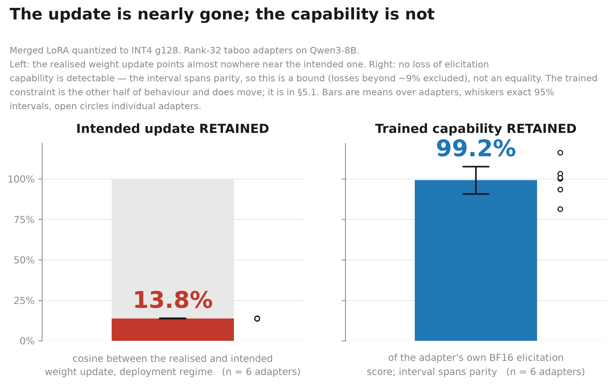

# Adapter retention under quantization

Code and data for *Weight-Space Erasure Without Behavioural Collapse in Quantized LoRA Adapters*

This study asks how much of a LoRA fine-tune survives when its weights are merged into a base model and quantized. The weight update changes substantially, but that alone does not tell us how the model's behaviour will change.

[Read the paper](paper/adapter-retention-arxiv.pdf) · [Technical report](paper/adapter-retention-technical-report.pdf) · [Reproduction instructions](REPRODUCING.md)



## Results

Across six taboo-word adapters, mean elicitation retention was **99.2%** at INT4 g128, **77.2%** at INT4 per-channel, and **57.8%** at INT3 g128.

Enumerated 95% interval at INT4 g128: [90.7%, 107.6%]. This supports no detectable loss on this battery; it does not establish identical behaviour. Individual retention spans **28.7% to 86.4%** at INT3, despite similar weight-space measurements.

The weight-space study covers nine adapters on two base models. The behavioural study covers six rank-32 adapters sharing one base model and one training recipe. Quantization is simulated with quantize/dequantize operations, rather than measured through fused inference kernels. The paper discusses failed instruments, corrected measurements, withdrawn predictions, and the limits of these comparisons.

<details>
<summary>Weight-space measurements</summary>

On a fixed grid, where a weight changes only when its delta clears the step size, 98.9% of codes are unchanged. On the deployment path, merging moves the grid, 85.5% of stored values change while only 2.1% of integer codes do. These counts describe different aspects of quantization; see the paper for their definitions.

| Adapter | Base | Rank | Scaling | Cosine | Code-flip rate | Relative error | Output SNR |
|---|---|---|---|---|---|---|---|
| taboo-smile | Qwen3-8B | 32 | 2.00 | 0.137 | 1.09% | 7.41 | 1.63 |
| taboo-moon | Qwen3-8B | 32 | 2.00 | 0.137 | 1.09% | 7.42 | 1.62 |
| taboo-snow | Qwen3-8B | 32 | 2.00 | 0.138 | 1.10% | 7.37 | 1.63 |
| taboo-gold | Qwen3-8B | 32 | 2.00 | 0.139 | 1.11% | 7.35 | 1.63 |
| taboo-ship | Qwen3-8B | 32 | 2.00 | 0.141 | 1.14% | 7.23 | 1.66 |
| taboo-rock | Qwen3-8B | 32 | 2.00 | 0.141 | 1.14% | 7.21 | 1.67 |
| latentqa | Qwen3-8B | 64 | 2.00 | 0.276 | 3.88% | 3.58 | 2.53 |
| responsible-ai-safety | Llama-3.1-8B | 16 | 2.00 | 0.330 | 6.19% | 2.90 | 6.00 |
| ao-v3-dpo-halluc | Qwen3-8B | 128 | 1.41 (rsLoRA) | 0.505 | 14.81% | 1.74 | 3.76 |

Relative error uses complete erasure as a baseline of 1.0. The table uses the fixed-grid measurements; behavioural runs use the deployment grid.

</details>

## Setup and checks

Use Python 3.11 or newer. Install PyTorch separately for your hardware, then the pinned dependencies. The original experiments used PyTorch 2.11.0 with CUDA 12.8; GPU measurements require BF16 support and enough memory for the selected model.

```bash
git clone https://github.com/MaximG6/adapter-retention-paper.git
cd adapter-retention-paper
python -m venv .venv
source .venv/bin/activate
pip install torch==2.11.0 --index-url https://download.pytorch.org/whl/cu128
pip install -r requirements.txt

PYTHONPATH=src python -m pytest -q
PYTHONPATH=src python analysis/audit_draft_numbers.py --strict
PYTHONPATH=src python analysis/retracted.py
PYTHONPATH=src python analysis/forward.py
PYTHONPATH=src python analysis/countcheck.py --strict
PYTHONPATH=src python analysis/xref.py --strict
```

The tests and analysis checks run on CPU using the committed records. Rerunning the model measurements requires a GPU and model downloads. See [Appendix D](paper/appendix-D-reproduction.md) for the original environment and measured runtimes.

### Every command, in order

The [reproduction guide](REPRODUCING.md) contains the complete measurement sequence, figure and PDF builds, GPU capability notes, and Windows long-path setup. Appendix D's references to README reproduction details are covered by that guide.

## Try the predictor

`ar.predict` estimates weight-space retention from an adapter without loading a full base model. It runs on CPU and downloads adapter tensors. It does not predict behavioural retention.

```bash
PYTHONPATH=src python -m ar.predict --adapter adamkarvonen/Qwen3-8B-taboo-smile_50_mix --bits 4 --group-size 128
```

## Repository contents

| Path | Contents |
|---|---|
| `paper/` | Manuscript sources, appendices, both PDFs, and both figure variants |
| `src/ar/` | Quantization, retention metrics, adapter handling, evaluation, and prediction |
| `scripts/` | Measurement and validation programs |
| `analysis/` | Tables, figures, numerical audits, and document checks |
| `results/raw/` | Experimental records and original run manifests |
| `tests/` | Unit tests and regression fixtures |

[EXPERIMENTS.md](EXPERIMENTS.md) records the runs and corrections. [METHODOLOGY.md](METHODOLOGY.md) explains the validation practices; [PROMPTS.md](PROMPTS.md) contains the experimental stimuli. The dated [research protocol](docs/PROJECT-EXECUTION-PLAN-v2.md) supports the registered predictions. [PROVENANCE.md](PROVENANCE.md) describes this release and the historical revision identifiers.

## Citation

```bibtex
@misc{adapter_retention_2026,
  author = {Gerasimov, Maxim},
  title  = {Weight-Space Erasure Without Behavioural Collapse in Quantized LoRA Adapters},
  year   = {2026},
  url    = {https://github.com/MaximG6/adapter-retention-paper},
}
```

Citation metadata is also available in [CITATION.cff](CITATION.cff). The repository is distributed under the [MIT license](LICENSE).
